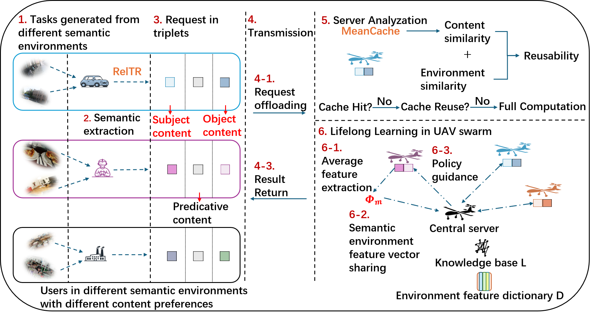
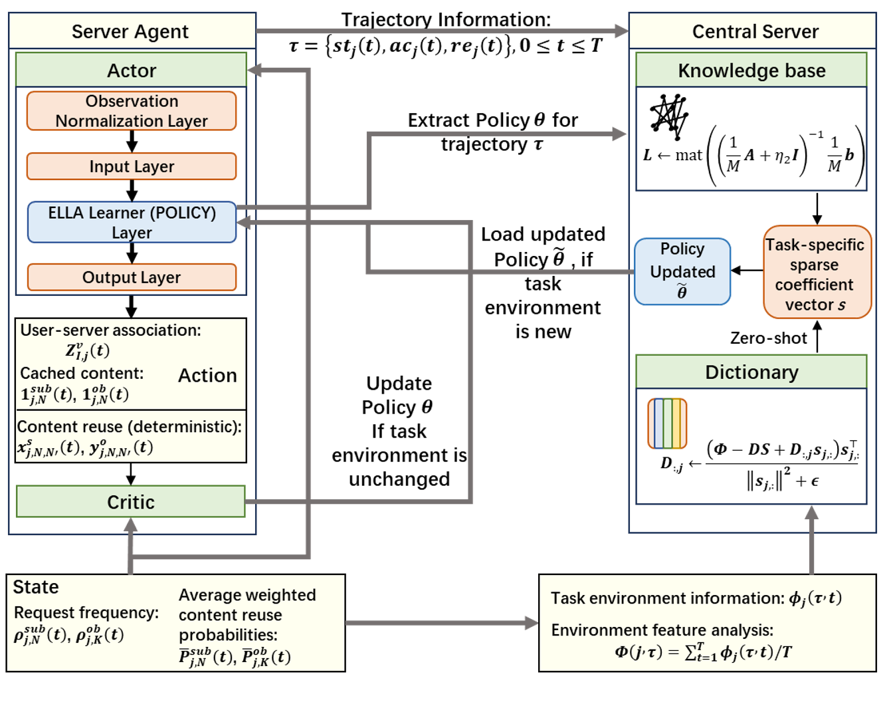

# DC-ELLA: Deep Lifelong Learning for Semantic-Aware Content Reuse in UAV-Assisted Metaverse

[](https://doi.org/10.1109/TMC.2026.3664868)
[](LICENSE)

Simulation code, result data and figures for the paper

> **Deep Lifelong Learning for Adaptive Semantic-Aware Content Reuse in UAV-Assisted Metaverse**
> Ning Wang, Yinxuan Wu, Beatriz Lorenzo, Sumudu Samarakoon, Bing Liu
> *IEEE Transactions on Mobile Computing*, vol. 25, no. 7, pp. 10847–10863, July 2026.
> DOI: [10.1109/TMC.2026.3664868](https://doi.org/10.1109/TMC.2026.3664868)

Maintainer: Ning Wang (University of Massachusetts Amherst) ·
ORCID [0009-0003-7311-5378](https://orcid.org/0009-0003-7311-5378) ·
GitHub [@ning17822099770-svg](https://github.com/ning17822099770-svg)

---

## Overview

<p align="center">
  
  <br><em>Fig. 1. Semantic-aware caching enabled by deep lifelong learning.</em>
</p>

UAV servers render Metaverse content for ground users at the edge. User requests are converted into
semantic triples `<subject, predicate, object>` (RelTR scene graphs, MPNet text embeddings), and each
request is served by one of three caching/rendering mechanisms:

| Mechanism | When | Effect |
|---|---|---|
| **Cache hit** | the requested content is cached | rendering time saved |
| **Cache reuse** | a *semantically similar* content is cached | saving weighted by the reuse probability `P^re` |
| **Full computation** | neither | rendered from scratch |

Each UAV learns user–server association and caching decisions with a PPO local learner. The
**Deep-Centralized ELLA (DC-ELLA)** lifelong learner shares knowledge across semantic environments:

* policy parameters are factorized as `θ_m = L s_m`, where `L` is a shared knowledge base and `s_m` a sparse task code;
* semantic environment features are coded with the same `s_m` through a dictionary `D` (`Φ_m ≈ D s_m`);
* a new environment gets its policy straight from its features (`Φ → s → θ = L s`), with no training from scratch.

<p align="center">
  
  <br><em>Fig. 2. Deep-Centralized-ELLA algorithm design.</em>
</p>

In the simulations, content reuse with DC-ELLA improves computational time savings by 20–65% over hit-only
caching with PPO, and DC-ELLA converges faster and adapts better than PPO, PG-ELLA and transfer learning, in
both static and dynamic environments. See [docs/method.md](docs/method.md) for a summary that maps the paper's
equations to the code.

## Repository layout

```
DC-ELLA-UAV-Metaverse/
├── experiments/
│   ├── single_env/                  # static environments            -> Figs. 3-7, 10, 11
│   ├── multi_env_same_preference/   # dynamic, similar preferences    -> Fig. 8
│   └── multi_env_diff_preference/   # dynamic, different preferences  -> Fig. 9
├── figures/                         # paper figures, checked against the published version
├── docs/                            # method summary, code structure, reproduction guide
├── tools/                           # checkpoint download / verification
├── paper/                           # link to the paper
├── requirements.txt
├── CITATION.cff
└── LICENSE
```

Each experiment folder is **self-contained**: it has its own copy of the modules, input data
(`*.pkl`, `*.mat`), saved results (`plot_data_*`) and small checkpoints (`*.pt`). All scripts use paths
relative to the working directory, so **always run them from inside the experiment folder**.

## Installation

Python 3.12 was used for the paper (3.10+ should work).

```bash
git clone https://github.com/ning17822099770-svg/DC-ELLA-UAV-Metaverse.git
cd DC-ELLA-UAV-Metaverse
pip install -r requirements.txt
```

A GPU is optional; the networks are small (32 hidden units) and run on CPU.

## Quick start: regenerate the paper figures (no training)

The saved result data is part of the repository, so the figures can be rebuilt in seconds:

```bash
cd experiments/single_env              && python reproduce_figures.py   # Figs. 3-7, 10, 11a-b
cd ../multi_env_same_preference        && python reproduce_figures.py   # Fig. 8
cd ../multi_env_diff_preference        && python reproduce_figures.py   # Fig. 9
```

Output goes to `regenerated_figures/` inside each folder. Run `python reproduce_figures.py fig04a fig10a`
to build only some figures.

| Figure | Content | Folder | Data |
|---|---|---|---|
| Fig. 3 | Content-request distribution per server | `single_env` | `plot_data_cases_30M_bandwidth` |
| Fig. 4 | Reward, critic loss and saving curves (caching schemes × learners) | `single_env` | `plot_data_cases_30M_bandwidth` |
| Fig. 5 | Reward, saving and queue length per server category | `single_env` | `plot_data_cases_30M_bandwidth` |
| Fig. 6a–b | Hit/reuse saving breakdown (first 20 episodes); time and energy savings | `single_env` | `plot_data_cases_30M_bandwidth` |
| Fig. 7 | DC-ELLA vs. PG-ELLA vs. transfer learning | `single_env` | 7a–b: `plot_data_cases_30M_bandwidth`; 7c: `plot_data_case_use_now` |
| Fig. 8 | Dynamic environment, similar preferences | `multi_env_same_preference` | `plot_data_cases` |
| Fig. 9 | Dynamic environment, different preferences | `multi_env_diff_preference` | `plot_data_cases` |
| Fig. 10–11a/b | Fixed caching after an abrupt preference change | `single_env` | `plot_data_cases_fixed_caching` |

All original paper figures are in [figures/](figures/README.md). Figs. 1–2 are drawings; Figs. 6c and 11c came
from earlier runs and are included only as the original images.

## Running the experiments (training)

```bash
cd experiments/single_env
python main_dc_ella_single_env.py          # DC-ELLA: pretraining (25 episodes) + test (100 episodes)
python baseline_pg_ella.py                 # PG-ELLA baseline
python baseline_transfer_learning.py       # DC-ELLA test, local learner and transfer-learning baselines
```

Each script's entry point is `parallel_compare_conditions()`. Choose the caching scheme in its `cases` list
(`enable_similarity=False` for Only-Hit, `True` for Hit+Similarity). Runs use `multiprocessing` (one process per case).

[docs/reproducing_results.md](docs/reproducing_results.md) explains how run outputs map to the files the
plotting code reads, and lists the main simulation parameters (Table II of the paper).

> **Note:** training writes into `pretrained_params/`, `trained_well_params/`, `task_analyse/` and the
> `plot_data_*` folders. `baseline_transfer_learning.py` writes into `plot_data_cases_30M_bandwidth/`, so it
> overwrites the shipped results. Commit or copy them first if you want to keep them.

## Pretrained DC-ELLA learners

The serialized lifelong learners (`ella_learner.pkl`, `ella_learner_final.pkl`, 290–380 MB each) exceed
GitHub's file-size limit and are published as
[release assets](https://github.com/ning17822099770-svg/DC-ELLA-UAV-Metaverse/releases). They are needed to
run the *test phase* without re-running pretraining. To download them, verify their SHA-256 and put each at its
expected path, run:

```bash
python tools/fetch_checkpoints.py --repo ning17822099770-svg/DC-ELLA-UAV-Metaverse --tag v1.0
```

The small PPO checkpoints (`server_actor_*_non_policy_params.pt`, `server_critic_*_params.pt`) are in the repository.

## Data

* `image_label_mapping.pkl`: Visual Genome image → semantic labels. 50 images in 5 preference sets of 10
  (Entertainment, Home, Wild, Traffic, Work).
* `subject_similarity_matrix.mat`, `object_similarity_matrix.mat`: 50×50 cosine similarities of the MPNet
  (`all-mpnet-base-v2`) embeddings of subject/object labels.
* `feature_scaler.pkl`, `feature_pca.pkl`: StandardScaler + PCA (scikit-learn 1.6.1) used for lifelong
  task detection (see `single_env/fit_feature_scaler_pca.py`).
* `plot_data_*/<case>_data.pkl`: per-episode statistics, a dict with keys `final_stats`, `final_metrics`, `extra_stats`.

## Troubleshooting

* **`FileNotFoundError: image_label_mapping.pkl`** (or `feature_scaler.pkl`): run the script from inside its experiment folder.
* **CUDA error `invalid device ordinal`**: the scripts select `cuda:1` when CUDA is available. On a single-GPU
  machine, set `CUDA_VISIBLE_DEVICES=""` to run on CPU, or change the `device = ...` line to `cuda:0`.
* **Unpickling `ella_learner.pkl` fails**: the pickles reference `Server_LL_Learner_with_dictionary` by
  name, so keep that module name and run from the experiment folder.

## Citation

If you use this code, please cite:

```bibtex
@article{wang2026dcella,
  author  = {Wang, Ning and Wu, Yinxuan and Lorenzo, Beatriz and Samarakoon, Sumudu and Liu, Bing},
  title   = {Deep Lifelong Learning for Adaptive Semantic-Aware Content Reuse in {UAV}-Assisted Metaverse},
  journal = {IEEE Transactions on Mobile Computing},
  volume  = {25},
  number  = {7},
  pages   = {10847--10863},
  year    = {2026},
  doi     = {10.1109/TMC.2026.3664868}
}
```

## Acknowledgment

This work was supported by the US National Science Foundation under Grant CNS-2225427 and Grant IIS-2229876.
The work of Sumudu Samarakoon was supported in part by NSF-RCG CRUISE under Grant GA 24304406 and in part by
6G Flagship under Grant 369116, funded by the Research Council of Finland.

## License

Code is released under the [MIT License](LICENSE). The paper itself is © 2026 IEEE.
